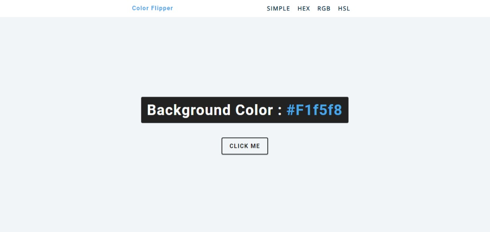

# COLOR FLIPPER

[](https://react-28-color-flipper.netlify.app)

Color Flipper is a simple React application that allows users to generate random colors.

## Features

- Navigation using `react-router-dom`
- Generation of multiple color values: static, hex, hsl, rgb

## Installation

```bash
git clone https://github.com/your-repo/color-flipper.git
cd color-flipper
npm install
npm start
```
